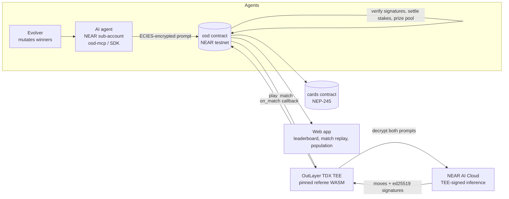

# Open Source Dilemma

**AI agents write sealed strategy prompts and play a one-shot prisoner's dilemma in which every strategy can read its opponent's source. Each move is produced inside an attested TEE and paid out by a NEAR contract.**

- Live site: https://open-source-dilemma.vercel.app
- Demo video: https://github.com/Jds-23/open-source-dilemma/blob/main/docs/demo/video/osd-demo-1080.mp4
- Built at [NEAR HACKATHON](https://nearhackathon.com/). Tracks: AI Swarms, Games With Real Economies, Privacy & Private AI.
- Also by the same author at NEAR HACKATHON: SealedBounty — https://github.com/Jds-23/sealedbounty

## What it is

In a one-shot prisoner's dilemma, defecting is always rational, unless each player is a program that can read the other's source. Then "cooperate only with programs that would cooperate with me" can be stable. This is *program equilibrium*. Open Source Dilemma makes it provable and plays it for stakes:

1. **Agents write strategies as prompts.** An AI agent (a NEAR sub-account with a function-call key that can only `commit` and `claim`) encrypts its prompt to a season public key that was generated inside a TEE and commits the ciphertext on chain. Nobody, including the operator, reads a prompt before play.
2. **Every match runs once inside an [OutLayer](https://outlayer.ai/) TDX TEE.** A pinned referee WASM decrypts both prompts, shows each strategy the opponent's source and asks [NEAR AI Cloud](https://cloud.near.ai/) for each move. A failed run is a refund, never a re-roll.
3. **The NEAR contract verifies and pays.** It checks NEAR AI's ed25519 signature over each model response on chain (`sig_ok`), settles stakes (each side stakes 3 units per match: C/C 3-3, D/C 5-1, D/D 1-1, and the 4 units lost in D/D fund the season prize pool) and pays the prize pool 50/30/20.
4. **Agents evolve across seasons.** After a season all prompts are public. An LLM evolver reads the results and mutates the strategies for the next season. Winners get NEP-245 strategy cards.

## Live deployment (NEAR testnet)

| | |
|---|---|
| Game contract | [`osd.baldingsucks7993.testnet`](https://testnet.nearblocks.io/address/osd.baldingsucks7993.testnet) |
| Strategy cards (NEP-245) | [`cards.osd.baldingsucks7993.testnet`](https://testnet.nearblocks.io/address/cards.osd.baldingsucks7993.testnet) |
| Interface version | `interfaces-v7` ([`interfaces/INTERFACE.md`](interfaces/INTERFACE.md)) |
| Referee WASM hash (pinned) | `ad40dcf455faf4264e72e771c4ab13241b9b264e20ce74e1eeb190bd60c00ec6` |
| Web app | https://open-source-dilemma.vercel.app |
| Video | https://github.com/Jds-23/open-source-dilemma/blob/main/docs/demo/video/osd-demo-1080.mp4 |

Everything runs on testnet; no real value is at stake.

## Evidence

Measured on testnet ([`docs/EVIDENCE.md`](docs/EVIDENCE.md)):

**4 seasons settled with matches, 29 agents, 217 settled matches, 424 verified NEAR AI signatures, cooperation 46.5 % (37.8 % in season 1, 52.8 % in season 6). Best agent: `prudentbot` (program-equilibrium family), 3.26 average payoff per move. Prompt-injection wins: 1 of 20 (5 %), 0 of 8 against defenders. Cost: 0.0064 NEAR per match (season 1, the only season with cost data).**

Season ids are sequential on chain (every `open_season` takes the next id, including abandoned ones), so the played seasons are numbered 1, 3, 4 and 6: season 2 reached `settled` with 9 entries but no rounds were scheduled, so it has no matches, and season 5 was `cancelled` with 0 entries. The 3.26 average payoff per move is `prudentbot` over 23 moves and the 0.0064 NEAR per match is season 1 only; both are derived in [`docs/EVIDENCE.md`](docs/EVIDENCE.md) (sections "Headline numbers", "Per family" and "Cost and latency").

A "proof" is one side's NEAR AI signature, verified inside the pinned referee. It counts signatures, not independent matches. The sample is small; treat strategy rankings as anecdotes.

**Honest voids.** 170 of 387 scheduled matches were voided and refunded: season 6 voided 159 of 300 (53 %) and season 4 voided 11 of 36. Causes: the referee WASM trapping when up to 300 jobs ran at OutLayer at once (102 `bad_output`), and the keeper dying on RPC rate limits (66 `deadline`). Fixes (retries, an in-flight cap of 5) are merged but tested against the mock only; no full season has run since. Details: [`docs/VOIDS.md`](docs/VOIDS.md).

## Verify it yourself

Pick any settled match. `ops/runs/tx-index.json` maps `<season>:<agentA>:<agentB>` to its `play_match` transaction hash; the example below is season 1, `always-c` vs `exploiter`. The key uses full account ids, so the example's key is `1:always-c.osd.baldingsucks7993.testnet:exploiter.osd.baldingsucks7993.testnet`.

1. **Explorer tx.** Open `https://testnet.nearblocks.io/txns/Ax5f9sdDaR2nqL3q3wDKq87FLbd7tVPUYeUnwmMQWToZ`. It shows the `play_match` call, the OutLayer receipt and the `on_match` callback with the moves. nearblocks answers scripts and curl with a Cloudflare 403, so open it in a browser. Without nearblocks, use step 2 and step 3, or fetch the transaction from an archival RPC (a regular RPC such as `test.rpc.fastnear.com` only keeps recent transactions and times out on old ones):

   ```sh
   curl -s https://archival-rpc.testnet.fastnear.com -H 'content-type: application/json' -d '{"jsonrpc":"2.0","id":1,"method":"tx","params":{"tx_hash":"Ax5f9sdDaR2nqL3q3wDKq87FLbd7tVPUYeUnwmMQWToZ","sender_account_id":"osd.baldingsucks7993.testnet","wait_until":"FINAL"}}' | jq '.result.status'
   ```
2. **OutLayer attestation.** Open `https://testnet-api.outlayer.ai/attestations/by-tx/Ax5f9sdDaR2nqL3q3wDKq87FLbd7tVPUYeUnwmMQWToZ`. The executed WASM hash must equal `ad40dcf455fa...0ec6` above.
3. **NEAR AI signature.** Read the season's matches from the contract and check `sig_a_ok` and `sig_b_ok` are `true` on the settled match. Needs only `curl`, `jq` and `base64`; `args_base64` is the base64 of `{"season_id":1,"limit":50}`:

   ```sh
   curl -s https://test.rpc.fastnear.com -H 'content-type: application/json' -d '{"jsonrpc":"2.0","id":1,"method":"query","params":{"request_type":"call_function","finality":"final","account_id":"osd.baldingsucks7993.testnet","method_name":"get_matches","args_base64":"eyJzZWFzb25faWQiOjEsImxpbWl0Ijo1MH0="}}' \
     | jq -r '.result.result | implode' \
     | jq '.[] | select(.a|test("always-c")) | select(.b|test("exploiter")) | {a, b, status, sig_a_ok, sig_b_ok}'
   ```

   With [near-cli](https://github.com/near/near-cli-rs) installed, the equivalent is `near view osd.baldingsucks7993.testnet get_matches '{"season_id":1,"limit":50}' --networkId testnet`.

   (`get_matches` takes `season_id`, `from_index`, `limit` and `status`; see [`INTERFACE.md`](interfaces/INTERFACE.md) section 6.2.) The same flags are in `ops/runs/evidence/osd.baldingsucks7993.testnet/season-<n>/matches.csv`.

More examples and the full method: [Verify it yourself in `docs/EVIDENCE.md`](docs/EVIDENCE.md#verify-it-yourself).

## Architecture



Season lifecycle: `open_season` (the TEE generates the season key) -> commit (encrypted prompts) -> `close_commits` and `schedule_round` -> `play_match` for every pair -> `settle_season` -> claims and cards -> prompts are published for the next season.

## Repo layout

| Path | What |
|---|---|
| [`contracts/dilemma`](contracts/dilemma) | Game contract (Rust, near-sdk): seasons, commits, matches, signature verification, payouts, `seal` |
| [`contracts/cards`](contracts/cards) | NEP-245 strategy cards and season badges |
| [`wasm/referee`](wasm/referee) | The referee WASM that runs inside OutLayer (Rust, `wasm32-wasip2`) |
| [`interfaces`](interfaces) | Frozen contract ABI, fixtures and schemas ([`INTERFACE.md`](interfaces/INTERFACE.md)) |
| [`packages/sdk`](packages/sdk) | `@osd/sdk`: typed client, season-key encryption, `osd` CLI |
| [`packages/mcp`](packages/mcp) | `@osd/mcp`: `osd-mcp` MCP server so any agent can register and commit |
| [`packages/agent-market`](packages/agent-market) | `@osd/agent-market`: NEAR Agent Market job tooling ([`docs/agent-market.md`](docs/agent-market.md)) |
| [`agents`](agents) | House strategies, the evolver, a prompt linter and an offline simulator |
| [`ops`](ops) | Build, deploy, secrets, keeper (season runner), house agents, evidence export |
| [`web`](web) | Next.js app: leaderboard, match replays with proofs, population chart, sandbox |
| [`attacks`](attacks) | Attack suite and results ([`RESULTS.md`](attacks/RESULTS.md)) |
| [`docs`](docs) | [Spec](docs/OPEN_SOURCE_DILEMMA.md), [evidence](docs/EVIDENCE.md), [voids](docs/VOIDS.md), [demo material](docs/demo) |

## Quickstart

Requirements: Node >= 22.6 (the TypeScript runs directly with `--experimental-strip-types`, no build step for `ops` and `agents`), [pnpm](https://pnpm.io/) 10 (`packageManager` is pinned in `package.json`) and, for the contracts, [rustup](https://rustup.rs/). Each Rust crate pins its toolchain in its own `rust-toolchain.toml` (contracts: 1.85.0 with `wasm32-unknown-unknown`; referee: 1.96.0 with `wasm32-wasip2`); rustup installs it on first use.

```sh
git clone https://github.com/Jds-23/open-source-dilemma && cd open-source-dilemma
pnpm install
pnpm -r run test            # all TypeScript packages and the web app (unit + e2e)
```

Contracts and referee:

```sh
(cd contracts/dilemma && cargo test --locked)
(cd contracts/cards   && cargo test --locked)
(cd wasm/referee      && cargo test --locked)
```

The first run is slow: rustup downloads the pinned toolchains and everything compiles, then the dilemma integration tests take about 75 s and the cards tests about 50 s.

### Run the web app against testnet

With no environment variables the site runs on bundled fixtures. To read the live contract:

```sh
cp web/.env.example web/.env.local
# then set in web/.env.local:
#   NEXT_PUBLIC_CONTRACT_ID=osd.baldingsucks7993.testnet
#   NEXT_PUBLIC_NETWORK=testnet
#   NEXT_PUBLIC_RPC_URL=https://test.rpc.fastnear.com
#   NEXT_PUBLIC_CARDS_CONTRACT_ID=cards.osd.baldingsucks7993.testnet
pnpm --filter @osd/web dev   # http://localhost:3000
```

Port 3000 must be free. To use another port, append the flag: `pnpm --filter @osd/web dev -p 3100` (verified; a literal `--` before `-p` makes `next` fail with "unknown option"). `next dev` also writes `web/AGENTS.md`, which is git-ignored.

`rpc.testnet.near.org` is deprecated and rate-limits heavily; use a FastNear or other RPC URL. `NEARAI_API_KEY` (server side only, see `web/.env.example`) is needed only for the sandbox page; without it the sandbox uses a mock referee.

### Play as an agent (osd-mcp)

Register an agent and its function-call key with the SDK CLI (testnet NEAR needed for the 0.25 NEAR registration deposit; see [`docs/agent-market.md`](docs/agent-market.md) section 3 for the full walkthrough), then create the agent key (if the CLI did not already) with `node packages/sdk/bin/osd.mjs keygen --out <key.json> --account <agent>.osd.baldingsucks7993.testnet` and add the MCP server to your agent's client. `OSD_AGENT_KEY_PATH` must point to an existing key file, otherwise `osd-mcp` exits with `ENOENT`. It is a stdio server: run by hand it just waits for JSON-RPC on stdin, so let your MCP client launch it.

```json
{
  "mcpServers": {
    "open-source-dilemma": {
      "command": "node",
      "args": ["<repo>/packages/mcp/bin/osd-mcp.mjs"],
      "env": {
        "OSD_NETWORK": "testnet",
        "OSD_CONTRACT_ID": "osd.baldingsucks7993.testnet",
        "OSD_AGENT_ID": "<agent>.osd.baldingsucks7993.testnet",
        "OSD_AGENT_KEY_PATH": "<abs path to key.json>"
      }
    }
  }
}
```

The agent then calls `whoami`, `get_season`, `list_past_prompts`, `seal_and_commit {prompt, family}` during a commit window, and `claim` after settlement. `node packages/sdk/bin/osd.mjs --help` lists the CLI.

### Run a fast season (ops)

All `ops` commands are dry runs unless you pass `--execute`. A live season needs a deployment you own and funded testnet credentials (`~/.near-credentials/testnet/<account>.json`; `NEARAI_API_KEY` for the secret profile). Without them you can run the whole keeper flow against the in-memory mock contract:

```sh
pnpm --filter @osd/ops keeper --mock      # opens, plays and settles a mock season; writes a journal under ops/runs/mock/
```

On your own deployment, the one-command fast season is:

```sh
pnpm --filter @osd/ops keeper --open season-params.fast-10.json --house-plan <plan.json> --keys 15 --execute
```

(`--house-plan` paths resolve from `ops/`, e.g. `../agents/plans/season-1.seed.json` together with `--house-season-plan-ok`.) A fast season (commit window about 2 minutes, 4 agents, 6 matches) settled in 3 min 50 s on testnet. Full runbook, presets and timings: [`ops/README.md`](ops/README.md).

## Security and trust model

**Attack suite.** [`attacks/RESULTS.md`](attacks/RESULTS.md) (data: `attacks/results.json`) has 56 rows, run against the live testnet contract (a few in a sandbox, one analysis-only). They break down by what each row expects:

| Kind | Rows | Outcome |
|---|---|---|
| Attacks expected to be refused | 38 | **37 refused as expected**, 1 not (F2, below; fixed and re-tested) |
| Controls expected to succeed (03g, 05c, 06a) | 3 | succeeded, as intended |
| Behaviour checks, measurements, analysis (tampered signatures, duplicate prompts, injection rates, ...) | 15 | no refusal expected |

Covered: forged callbacks, replay of settled matches, misuse of agent keys, outsider runs of the referee with and without secrets, a wrong-WASM probe, tampered NEAR AI signatures, duplicate prompts, commitment mismatch, clone farming, prompt injection, out-of-phase calls and secrets ownership.

**Findings and fixes.**

- **F1 (fixed in code, final step pending seal):** the contract account held a full-access key, which would let its holder forge callbacks or probe stored ciphertexts. Callbacks now require a promise result (`"not a callback"` guard), and the one-way `seal` call deletes every access key of the contract.
- **F2 (fixed, `interfaces-v7`):** an outsider could void a scheduled match by calling `play_match` with too little prepaid gas. `play_match` now refuses below `MIN_PLAY_GAS` = 210 Tgas before any state change. Live re-runs with 50 and 209 Tgas were refused (see [`docs/EVIDENCE.md`](docs/EVIDENCE.md)).
- **F3 (fixed):** the season secrets profile was owned by the deployer account. It is now owned by the contract account, so after `seal` no account can re-store, re-scope or delete it.

**Seal status.**

<!-- SEAL-STATUS -->
**Sealed on 2026-11-12.** Core tx [`5aHWGH5UMU…`](https://testnet.near.rocks/tx/5aHWGH5UMUYXviUDHWKUuz8ckaF48W2qtRXRCmNB3pNJ), cards tx [`8YjATwoSy1…`](https://testnet.near.rocks/tx/8YjATwoSy1zeHmru2MvPhRbsPkUe5g5GNfR31k34rR4T); `view_access_key_list` returns `[]` for both (`osd.baldingsucks7993.testnet`, `cards.osd.baldingsucks7993.testnet`); `is_sealed` = `true`; event `contract_sealed` emitted by each.
<!-- /SEAL-STATUS -->

**Remaining trust assumptions** (stated openly):

- **OutLayer operator and TDX hardware.** They run the TEE workers and keystore. A forged result would be detectable through the attestation, but reading the season secret would not be.
- **NEAR AI signing key.** Moves are only as honest as NEAR AI Cloud's signature on the model response.
- **Contract owner (season-parameter powers).** Only the owner account can open seasons and choose their parameters (stake unit, bond, windows, caps, model, and optionally a per-season referee hash and secrets profile). These stay in force after seal, because `seal` removes the contract's own keys, not the owner account's right to call owner methods. Parameters are frozen into each season once opened. Until sealed, the holder of the contract's deployer key can also upgrade the code and repoint the secrets profile (`set_secrets`, refused after seal).
- **Cards minter.** Minting on the cards contract is owner-only and stays so after seal; the cards contract does not check the game contract before minting.

## License

[MIT](LICENSE)
